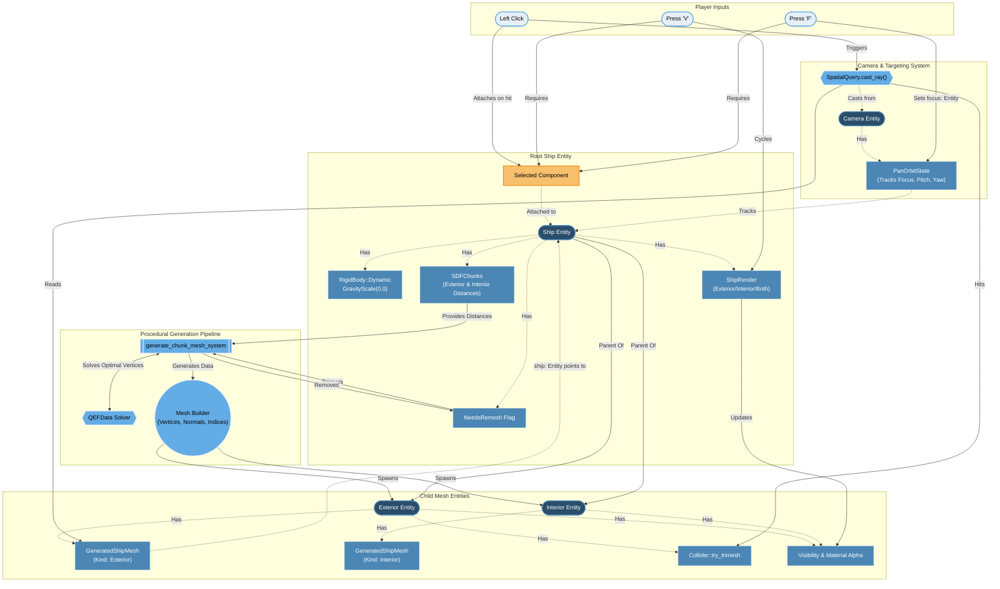

````mermaid
flowchart TD
    %% Styling definitions
    classDef plugin fill:#1b2a49,stroke:#465c8b,stroke-width:2px,color:#fff
    classDef entity fill:#2a4d69,stroke:#4b86b4,stroke-width:2px,color:#fff
    classDef component fill:#4b86b4,stroke:#adcbe3,stroke-width:1px,color:#fff
    classDef system fill:#63ace5,stroke:#e7eff6,stroke-width:2px,color:#000
    classDef ui fill:#465c8b,stroke:#adcbe3,stroke-width:2px,color:#fff

    %% ==========================================
    %% CAMERA MODULE
    %% ==========================================
    subgraph CameraModule ["📂 camera/mod.rs (Camera Plugin)"]
        direction TB
        CamEntity(["Commander Camera Entity"])
        CamComp["CommanderCamera<br/>(RenderState, InputMode)"]
        PanComp["PanOrbitState<br/>(Radius, Focus)"]

        SysCalcZoom[["System: decide_render_mode"]]
        SysInput[["System: handle_camera_input"]]

        CamEntity -.->|Owns| CamComp & PanComp
        SysCalcZoom -->|Reads| PanComp
        SysCalcZoom -->|Updates| CamComp
    end

    %% ==========================================
    %% SHIP MODULE
    %% ==========================================
    subgraph ShipModule ["📂 ship/mod.rs (Ship Plugin)"]
        direction TB
        ShipRoot(["Ship Root Entity"])
        SDFComp["SDFChunks (Voxels)"]
        AsciiComp["AsciiRepresentation"]

        ChildMesh(["Child: 3D Mesh Entity"])
        ChildText(["Child: Text2d Entity"])
        VisMesh["Visibility (Mesh)"]
        VisText["Visibility (Text)"]

        SysSpawn[["System: spawn_ship"]]

        ShipRoot -.->|Owns| SDFComp & AsciiComp
        SysSpawn -->|Constructs| ShipRoot
        SysSpawn -->|Spawns| ChildMesh & ChildText
        ChildMesh -.->|Owns| VisMesh
        ChildText -.->|Owns| VisText
    end

    %% ==========================================
    %% LOD / RENDER RULES MODULE (The Glue)
    %% ==========================================
    subgraph RenderModule ["📂 tactical_render/mod.rs (Tactical Plugin)"]
        SysLOD[["System: apply_tactical_lod"]]
    end

    %% ==========================================
    %% TERMINAL MODULE
    %% ==========================================
    subgraph TerminalModule ["📂 terminal/mod.rs (UI Plugin)"]
        UIEgui[/"Egui Terminal Window"/]
        SysRenderUI[["System: draw_terminal_ui"]]
        SysParse[["System: parse_commands"]]
    end

    %% ==========================================
    %% RELATIONSHIPS (The "Everything Else")
    %% ==========================================

    %% LOD System connects Camera Data to Ship Data
    CamComp -.->|Read State by| SysLOD
    SysLOD -->|Toggles| VisMesh
    SysLOD -->|Toggles| VisText

    %% Terminal reacts to Camera Input Mode
    CamComp -.->|Read Mode by| SysRenderUI
    SysRenderUI -->|Draws| UIEgui
    UIEgui -->|Submits string to| SysParse
    SysParse -->|Pushes to ShipCommandQueue| ShipRoot

    class CameraModule,ShipModule,RenderModule,TerminalModule plugin
    class CamEntity,ShipRoot,ChildMesh,ChildText entity
    class CamComp,PanComp,SDFComp,AsciiComp,VisMesh,VisText component
    class SysCalcZoom,SysInput,SysSpawn,SysLOD,SysRenderUI,SysParse system
    class UIEgui ui
    ```
````
